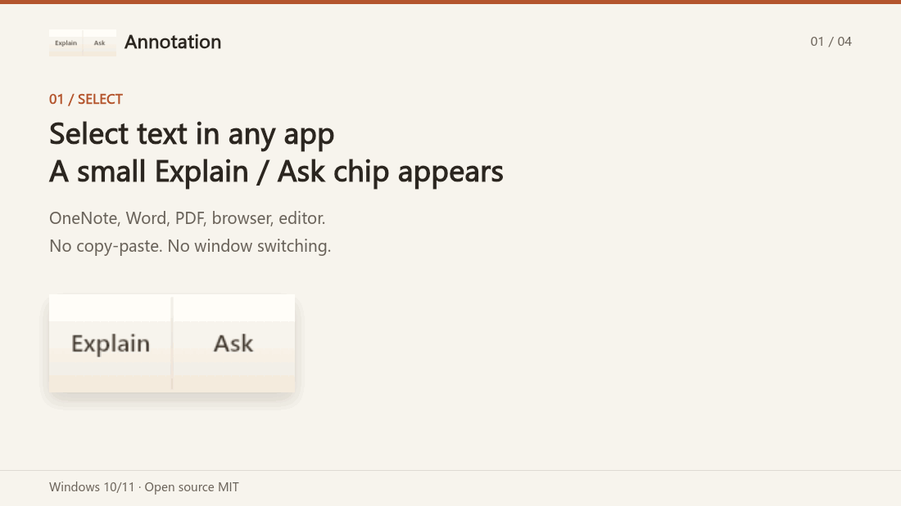
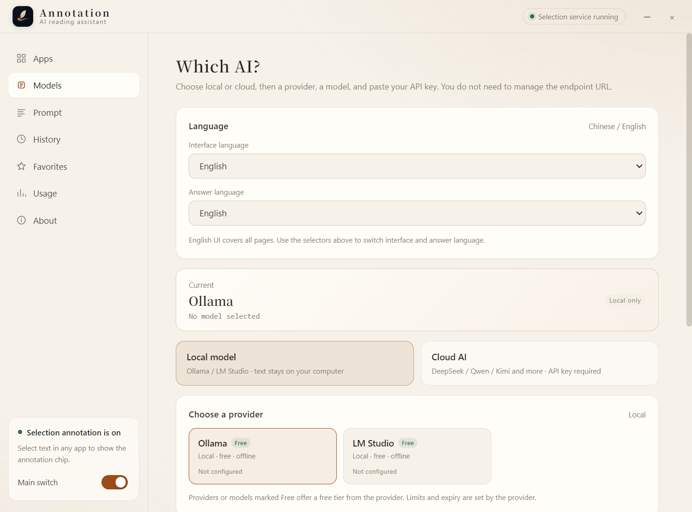
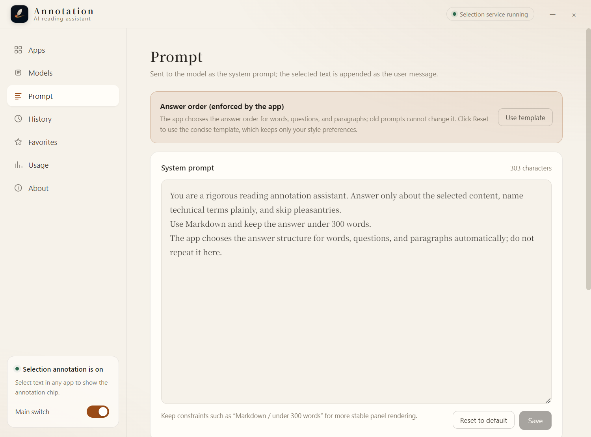
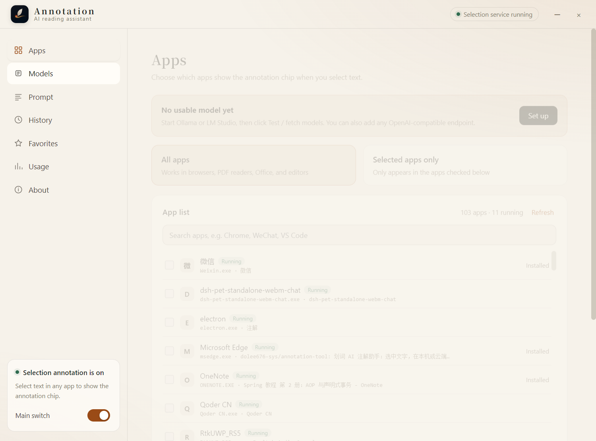
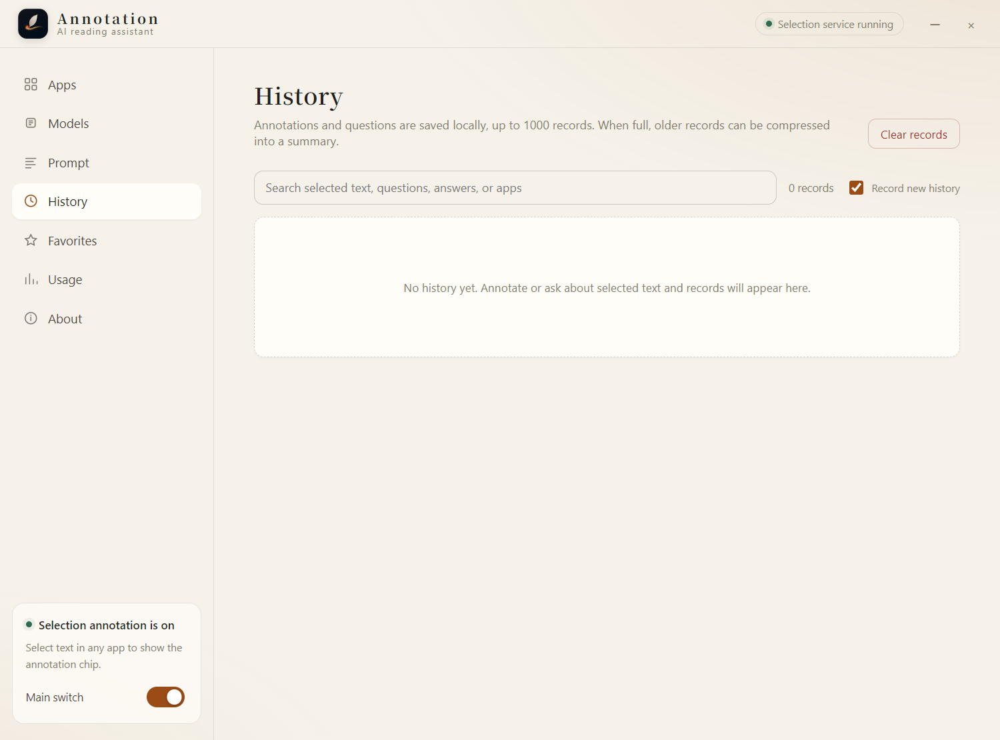

# Annotation · AI reading assistant

[简体中文](README.md) | English

[](https://github.com/dolee676-sys/annotation-tool/actions/workflows/ci.yml)
[](LICENSE)
[](#download-and-install-windows-1011)
[](https://raw.githubusercontent.com/dolee676-sys/annotation-tool/main/android-release/zhujie-tablet-latest.apk)

**Select text in any app. AI explains it with the surrounding context. If the selection is a question, it answers first, then explains.**

Works in OneNote, Word, PDF readers, browsers, and editors. Use a local model or your own cloud API key. Costs stay visible. A companion Android tablet build is also available (personal use).

[**Download for Windows**](https://github.com/dolee676-sys/annotation-tool/releases/latest) · [**Android tablet download**](https://raw.githubusercontent.com/dolee676-sys/annotation-tool/main/android-release/zhujie-tablet-latest.apk) · [15-second demo](#demo) · [What it solves](#what-it-solves) · [First run](#first-run)

> Made by piona · MIT License · [GitHub repository](https://github.com/dolee676-sys/annotation-tool)

## Demo



Real UI demo: select text → Explain / Ask → context-aware answer → follow-up. The model shown in the screenshots is a self-test placeholder. The GIF uses a Chinese panel sample; the full app UI can be switched to English under Settings → Models → Language.

## Screenshots

| Settings and language | Prompt and answer order |
| --- | --- |
|  |  |
|  |  |

## What it solves

Annotation focuses on the part of reading that takes the most effort: it sends more than the selected characters, reads the paragraph around them, routes the request as a word / question / paragraph, and keeps cost and history locally.

- **Context, not just the selection**: select a term in OneNote, Word, or a PDF and it reads the paragraph around it.
- **Two actions**: Explain explains term → current context → role. Ask answers the question first, then explains. Both support follow-ups.
- **Local or cloud**: Ollama / LM Studio run locally for free. Cloud providers use your own API key; multipliers, cost, and history stay visible.

> If this saves you time, a star helps others find it. For bugs or ideas, open an [issue](https://github.com/dolee676-sys/annotation-tool/issues).

## Download and install (Windows 10/11)

> Windows 10/11 x64. The release is a portable zip; no installer required.
>
> Download the latest release: **[Releases](https://github.com/dolee676-sys/annotation-tool/releases/latest)**.

1. Download `zhujie-win-x64.zip`.
2. Extract the whole folder to any drive, for example `D:\Apps\zhujie`.
3. Open the extracted `win-unpacked` folder and run `注解.exe` (the executable name is Chinese).
4. If Windows SmartScreen says "Windows protected your PC", click **More info → Run anyway**. The build is currently unsigned; this warning is expected.
5. The settings window opens on first launch. After closing it, the app stays in the system tray; double-click the tray icon to reopen it.
6. Optional: right-click `注解.exe` → Send to → Desktop (create shortcut).

Notes:

- Keep the whole folder. `注解.exe` needs the adjacent `resources` folder.
- Config, history, and usage live in `%APPDATA%\zhujie`; the program can live on any drive.
- Upgrade: quit the app, replace the program folder; data is preserved.
- Uninstall: quit the app, delete the program folder and `%APPDATA%\zhujie`.

## Android tablet (personal use)

> A companion build for Android tablets, used on an OPPO Pad 4 Pro / Android 15. It is not published to app stores and the UI is Chinese. It shares the desktop answer logic, prompts, and price multipliers.
>
> Download (always the latest build): [zhujie-tablet-latest.apk](https://raw.githubusercontent.com/dolee676-sys/annotation-tool/main/android-release/zhujie-tablet-latest.apk) — install it directly.
>
> Versioned packages and the update manifest live in the [android-release folder](https://github.com/dolee676-sys/annotation-tool/tree/main/android-release); see `latest.json` for the current version.

- Install the APK (allow unknown sources for this install), add your cloud API key in Settings, pick a model and test. There is no local Ollama on the tablet.
- Enable the "注解 · 划词" accessibility service in system settings; re-toggle it after each overwrite install.
- Where an app exposes selection, a 注 / 问 (Explain / Ask) chip appears next to the text. In OneNote and similar apps that do not expose selection, tap the edge "划" bubble to freeze the page and drag over the text, or copy the text and use "读剪贴板" (read clipboard).
- Screenshot OCR uses a Qwen vision model with your own key; answers, follow-ups, history, favorites, usage, multipliers, and the draggable / pinnable / favoritable panel behave like the desktop version.
- Updates are checked in-app and verified with SHA-256 and version code; a package older than the installed one is rejected instead of being handed to the installer.

Limits: personal, unsigned build (the system will warn on install); screenshot capture needs Android 11+ (minimum install Android 8); cloud OCR / answers send the selected text to the provider you configure, so avoid sensitive content.

## First run

The app starts in **Local only** mode. If you do not have Ollama / LM Studio installed, switch to **Cloud AI**, otherwise no model will be available.

### Option A: Cloud provider

1. Open **Settings → Models**.
2. Choose **Cloud AI**.
3. Pick a provider: DeepSeek, Qwen / Alibaba Cloud Bailian, Kimi, GLM, OpenAI, or any OpenAI-compatible endpoint.
4. Paste your API key, choose a model, then click **Save and test**.
5. Each provider card includes a setup guide (in Chinese) for creating a key and topping up.

> For Alibaba Cloud Bailian, the app filters out models that cannot handle text chat and marks third-party models hosted by Bailian as **"· 百炼版"** (Bailian edition), because they are billed through your Bailian account.

### Option B: Local model

1. Install Ollama or LM Studio.
2. In the app, choose **Local model → Ollama / LM Studio**.
3. Click **Detect local models and enable**.

> Local mode only connects to `127.0.0.1`; selected text never leaves the machine.

## Features

- Cross-app selection chip with **Annotate** and **Ask** actions.
- Context-aware answers, including OneNote document-text fallback.
- Separate word / question / paragraph answer standards.
- Multi-turn follow-ups; the last 4 turns are kept in context.
- History grouped by conversation, favorites, and token/cost statistics.
- Local and cloud providers; per-model cost multipliers; bring your own key.
- Tray app; fullscreen-friendly panel; full Chinese and English UI, including provider guides, history, favorites, usage, and About.
- Update checks from GitHub Releases; downloaded updates are verified with SHA-256.

## Privacy

- **Local mode**: no network requests; selected text stays on the machine.
- **Cloud mode**: the selected text and context are sent to the provider you choose.
- API keys are encrypted with Electron `safeStorage` when available.
- History and usage are stored locally under `%APPDATA%\zhujie`.
- The app does not run a remote server.

## Status and limitations

- Windows 10/11 x64 only.
- The UI can be switched between Chinese and English under Settings → Models → Language.
- The build is unsigned while the SignPath Foundation application is pending, so SmartScreen may warn on first launch.
- Context capture relies on Windows UI Automation. Some apps (Chromium PDF viewers, elevated windows, remote desktop, exclusive-fullscreen games) may not expose text; the app then sends only the selection.
- Early-stage project. Issues and feedback are welcome.

## Code signing and privacy

- **Code signing:** Windows releases are applying to the [SignPath Foundation](https://signpath.org/) open-source signing program. The certificate is issued to SignPath Foundation, not to the maintainer; builds remain unsigned until the application is approved. See [CODE_SIGNING_POLICY.md](CODE_SIGNING_POLICY.md).
- **Privacy:** the project has no developer account, telemetry, analytics, or cloud sync. Local mode does not send text off the device; cloud mode sends selected text, context, and questions only to the model provider you choose. See [PRIVACY.md](PRIVACY.md).

## Build from source

Requirements: Node.js 24 and Windows.

```bash
npm install
npm run dev
npm run typecheck
npm test
npm run build
npm run dist
```

For provider tutorials and Chinese troubleshooting, see the [Chinese README](README.md).

## Credits and licenses

This project is MIT. Direct runtime dependencies include [selection-hook](https://github.com/0xfullex/selection-hook) (MIT), Electron (MIT), React / React DOM (MIT), [marked](https://github.com/markedjs/marked) (MIT), and [DOMPurify](https://github.com/cure53/DOMPurify) (Apache-2.0 OR MPL-2.0). GPL/AGPL projects reviewed for product and interaction research were not copied. See the Chinese README for the full reference table.

## License

MIT. See [LICENSE](LICENSE).
