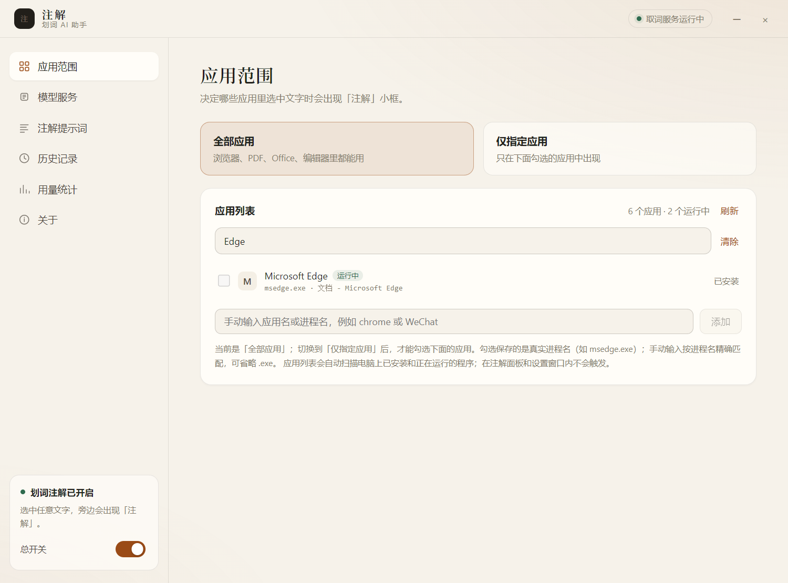
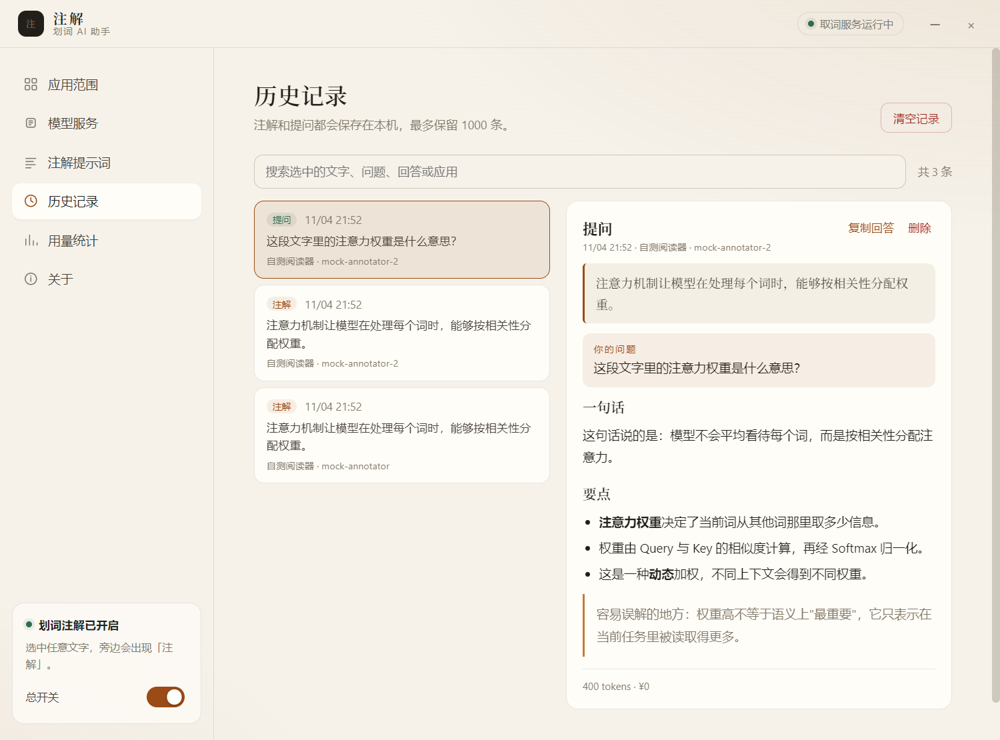
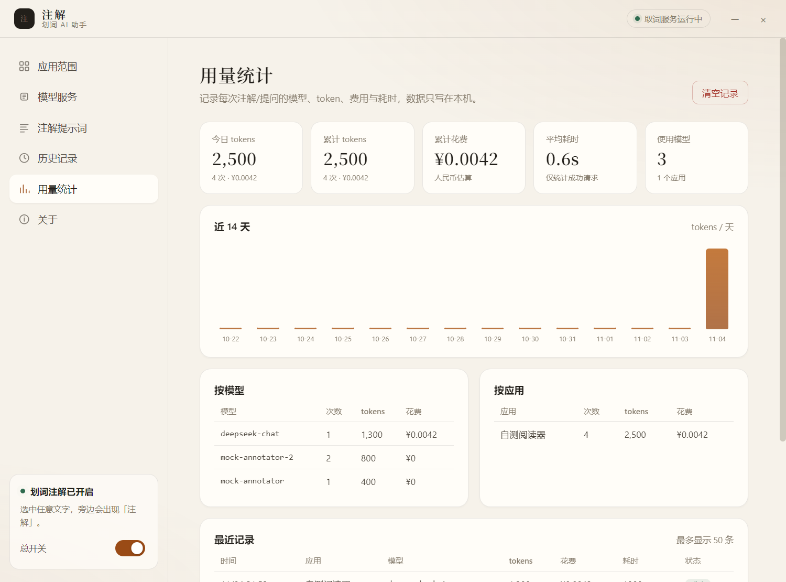

# 注解 · 划词 AI 助手

> 制作人：piona · MIT License

在任意应用里选中一段文字，旁边会出现「注解 / 提问」小框；点开就是 AI 解析或问答。默认只连本机模型，可切换模型、按应用启用，并记录每次调用的 token、费用和历史对话。


## 能力对照

| 需求 | 实现 |
| --- | --- |
| 选中文字后旁边出现小框 | `selection-hook` 通过系统无障碍 API 拿到选中文字与屏幕坐标，Electron 透明置顶窗口贴在选区右下角 |
| 小框写「注解」 | 88×74 的无边框、不抢焦点窗口，上下两个按钮 |
| 点开是 AI 解析 | 600×640 面板，流式请求，Markdown 渲染，可复制 / 重新生成 / 切换模型 |
| 还可以直接提问 | 小框里「注解」下面有「提问」：输入问题，AI 结合选中文字回答，可继续追问 |
| 结合上下文 | 默认读取选中位置前后各 300 字，把选中部分标成【选中】后一起发给模型；读不到时自动回退 |
| 锁定面板 | 面板右上角钉子按钮：钉住后点外面不关闭，再点一次取消 |
| 点外面关闭 | 默认未钉住时，点击面板之外的区域会关闭当前面板 |
| 选择在哪个应用上使用 | 「全部应用 / 仅指定应用」；自动记录实际划词来源应用，勾选即启用 |
| 仅在本电脑运行 | 默认开启「仅本机」，非 localhost 的 Base URL 直接拦截；Ollama / LM Studio 开箱可用 |
| 可切换模型 | 设置里选服务商、模型、填 Key；注解面板内也能直接切；切换后立即重答并记住默认模型 |
| 记录模型用量 | 每次请求记录模型、应用、prompt/completion tokens、耗时、成功状态；按模型 / 应用 / 天聚合 |
| 记录花费 | 按内置价目估算人民币费用，本机模型为 0；自定义接口可填输入/输出价格 |
| 历史对话 | 注解和提问全文保存在本机，可搜索、查看、复制、单条删除或清空 |

## 快速开始

> 仓库已包含 MIT 许可证、CI 配置和贡献指南；截图使用演示应用数据，不包含本机真实软件列表。

要求：Node.js ≥ 18、Windows 10/11（当前主要验证平台）。

```bash
npm install
npm run dev
```

如果使用 npm 11，安装脚本可能被拦下。先允许原生依赖与 Electron 的安装脚本：

```bash
npm approve-scripts electron esbuild selection-hook
```

国内网络下载 Electron 较慢时，可指定镜像：

```bash
ELECTRON_MIRROR=https://npmmirror.com/mirrors/electron/ npm install
```

### 桌面快捷方式

已安装到 D 盘，桌面快捷方式名为「注解」：

- 程序：`D:\Apps\zhujie\注解.exe`
- 快捷方式：`%USERPROFILE%\Desktop\注解.lnk`
- 配置与用量：`%APPDATA%\zhujie`（只有几 MB，保留在 C 盘）

重新构建后需要同步到安装目录时：

```bash
npm run build
npx electron-builder --win --dir --x64 --config.win.signAndEditExecutable=false
powershell -ExecutionPolicy Bypass -File scripts/install-shortcut.ps1
# 如需改安装位置：
# powershell -ExecutionPolicy Bypass -File scripts/install-shortcut.ps1 -InstallDir 'D:\Apps\zhujie'
```

> `signAndEditExecutable=false` 是为了绕开本机 Windows 无法创建符号链接、导致 electron-builder 解压签名工具失败的问题。exe 未做代码签名，首次运行时 SmartScreen 可能提示，选择“仍要运行”即可。

### 用哪家 AI

打开「模型服务」，只有三步：

1. 选「本机模型」或「云端 AI」；
2. 选服务商：本机是 Ollama / LM Studio，云端是 DeepSeek、通义千问、Kimi、智谱 GLM、OpenAI；
3. 选模型；云端再粘贴 API Key，点「保存并测试」。

接口地址、协议这些都收在「高级：手动填写接口地址」里，普通使用完全不用看。


本机模型示例：

```bash
ollama serve
ollama pull qwen2.5:7b
```

然后选「本机模型」→ Ollama → 点「检测本机模型并启用」。

云端示例：选「云端 AI」→ DeepSeek → 模型选 `deepseek-chat` → 粘贴 API Key（页面上有“去获取”的链接）→ 点「保存并测试」。

- 云端模式：选中的文字会发送给对应服务商，不要用于敏感内容。
- 本机模式：请求只发往 `127.0.0.1`，文字不离开电脑。

### 划词后的两个按钮

选中文字后，旁边会上下出现两个按钮：

- **注解**：直接生成解析；
- **提问**：打开输入框，输入你的问题，AI 会结合选中的文字回答；回答完还可以继续问。


> 提问和注解共用同一套模型设置；面板顶部可以随时切换模型。

### 结合上下文

「注解提示词」页有「结合上下文」开关，默认开启，前后各 300 字，可改成 100–1000 字。

- 点「注解 / 提问」时，通过 Windows 无障碍接口读取当前应用选中位置附近的文字，标记出【选中】部分后一起发送；
- 不截屏，只读取当前应用暴露给系统的文本；
- 有些应用/浏览器/PDF 阅读器不向系统暴露文本，此时自动只发选中文字，面板会显示「未读取到上下文」；同一应用 10 分钟内不再重试，避免每次等待；
- 费用按实际 token 记录，前后各 300 字通常约为原来的 1.5–2 倍。

### 面板操作

- 面板默认 600×640，可拖拽、可继续拉伸；
- 右上角钉子按钮：点一下钉住，面板保持显示；再点一下取消钉住；
- 未钉住时，点击面板外面会关闭当前面板；
- `Esc` 也可以关闭面板。

### 选择应用范围

打开「应用范围」会自动扫描电脑上已安装和正在运行的应用，显示应用名、进程名和窗口标题：

- 顶部搜索框可按应用名 / 进程名 / 窗口标题过滤，例如输入 `Edge`、`微信`、`Code`；
- 「运行中」标记表示程序当前正在运行，「已安装」来自开始菜单快捷方式；
- 点「刷新」重新扫描；
- 选「仅指定应用」后勾选即可；勾选保存的是真实进程名（如 `msedge.exe`），避免同名或改名后选错；
- 列表里没有时，仍可在底部手动输入进程名。



### 历史记录

「历史记录」保存每次注解/提问的选中文字、问题、回答、模型和费用，支持搜索、复制回答、单条删除和清空。最多保留 1000 条，只写在本机。



### 用量与费用

费用按内置价目估算（人民币），本机模型为 0；自定义接口可在「高级」里填写输入/输出价格。实际账单以服务商为准。



## 常用命令

```bash
npm run typecheck   # 主进程 + 渲染进程类型检查
npm run build       # 生产构建到 out/
npm run dev         # 开发模式（Vite + Electron）
npm run selftest    # 构建并用本地 mock 模型跑通全链路，截图写入 selftest/
npm run dist        # electron-builder 打包（本机未验证，见“验证记录”）
```

## 数据与隐私

- 配置：`%APPDATA%/zhujie/settings.json`
- 用量：`%APPDATA%/zhujie/usage.jsonl`（应用内「关于」页可看到实际路径）
- 历史对话：`%APPDATA%/zhujie/history.jsonl`（最多 1000 条；用量最多保留 20000 条，超出自动压缩）
- API Key：Electron `safeStorage` 加密后写入配置；渲染进程只能看到“是否已保存”，拿不到明文
- 默认「仅本机」：只允许 `localhost` / `127.0.0.1` / `::1` 的地址；关闭后才会访问你配置的云端接口
- 无账号、无遥测、无云同步

## 结构

```text
src/main/index.ts        应用生命周期、IPC 编排、流式请求与用量落库
src/main/selection.ts    全局取词、鼠标/键盘钩子、物理像素 → DIP
src/main/windows.ts      小框 / 注解面板 / 设置窗口 / 托盘
src/main/ai.ts           Ollama 原生 + OpenAI 兼容流式客户端、token 统计
src/main/settings.ts     配置持久化、应用白名单、密钥加密
src/main/usage.ts        JSONL 用量记录与聚合
src/main/history.ts      JSONL 历史对话
src/shared/pricing.ts    内置人民币价目与费用估算
src/preload/index.ts     类型化 IPC 桥
src/renderer/            React 界面（单入口按 hash 分流）
src/shared/types.ts      主进程 / 渲染进程共享契约
```

技术选型说明：全局划词没有用“模拟 Ctrl+C + 轮询剪贴板”这种侵入式方案，而是用 `selection-hook` 优先走 UI Automation / Accessibility API，拿到的数据里同时包含**选中文本、四角坐标和来源应用名**，剪切板只作为最后回退。

## 参考项目与许可证

本项目以 MIT 发布。调研与使用情况如下：

| 项目 | 许可证 | 用法 |
| --- | --- | --- |
| [0xfullex/selection-hook](https://github.com/0xfullex/selection-hook) | MIT | **直接依赖**：全局划词取词、坐标、应用名、鼠标键盘钩子 |
| [zcx960/AIA-selection-assistan](https://github.com/zcx960/AIA-selection-assistan) | MIT | 交互与窗口定位思路参考（Electron + selection-hook）；未整体照搬 |
| [Cherry Studio](https://github.com/CherryHQ/cherry-studio) | AGPL-3.0 | 划词助手产品形态调研；**未复用代码** |
| [pot-desktop](https://github.com/pot-app/pot-desktop) | GPL-3.0 | 划词翻译交互调研；仓库已归档，**未复用代码** |
| [nextai-translator](https://github.com/nextai-translator/nextai-translator) | AGPL-3.0 | 桌面划词产品调研；**未复用代码** |
| [STranslate](https://github.com/STranslate/STranslate) | MIT | Windows 划词/OCR 产品调研；未复用代码 |

> 直接把 AGPL / GPL 项目的代码搬进闭源或商用产品会带来许可证传染风险，因此这里只借鉴产品形态，实际实现基于 MIT 的 `selection-hook` 重写。

## 验证记录

已执行（2026-11-04，Windows）：

- `npm run typecheck`：通过
- `npm run build`：通过（主进程 / 预加载 / 渲染进程）
- `npm run selftest`：通过
  - 模拟划词 → 小框 → 通过小框点击事件打开面板 → 流式输出 → 入库
  - 注解 2 次、提问 1 次，共 3 次真实请求 / 1200 tokens；按模型聚合为 `mock-annotator` / `mock-annotator-2`
  - 提问面板：点击小框下半部「提问」→ 输入问题 → 结合选中文字回答 → 记录用量
  - 历史记录：3 条（2 条注解 + 1 条提问），全文可查看
  - 钉子按钮：点击后状态为 pinned=true，再点恢复 false
  - 费用：`deepseek-chat` 100 万输入 + 100 万输出估算为 ¥10；另加 1 条 ¥0.0042 的计费样例用于核对用量页显示
  - Ollama 原生 NDJSON 路径独立验证：240 tokens（150 prompt + 90 completion），模型列表拉取正常
  - 应用扫描：102 个应用 / 7 个运行中；在搜索框输入 `Edge` 后只显示 Microsoft Edge
  - 「仅指定应用」白名单拦截验证通过
  - 取词服务状态 `running`
  - 小框透明裁切：移除运行期 `setBackgroundColor`（在 Windows 上会把透明窗口刷成灰底），系统级截图确认按钮外围不再有方形底
  - 结合上下文：提示词构建验证通过；可访问的前台文档能读到约 600 字（前后各 300 字）；测试窗口未向 UIA 暴露选区时自动回退，不影响取词与回答
  - 上下文失败按应用冷却 10 分钟；上下文记录写入用量和历史
- 截图：`selftest/chip.png`、`selftest/panel.png`、`selftest/panel-pinned.png`、`selftest/panel-switch.png`、`selftest/panel-ask.png`、`selftest/panel-ask-answer.png`、`selftest/history.png`、`selftest/settings.png`、`selftest/settings-search.png`、`selftest/models.png`、`selftest/models-cloud.png`、`selftest/prompt.png`、`selftest/usage.png`
- 真实取词：自测期间记录到本机前台应用的划词事件（应用名已隐去），说明全局钩子与应用名识别在真实环境生效
- 打包版：`electron-builder --win --dir` 生成 `release/win-unpacked/注解.exe`；打包版执行 `--selftest` 同样通过（requests=4、tokens=2500、取词服务 running），原生 `selection-hook.node` 已正确解包
- 桌面快捷方式：`%USERPROFILE%\Desktop\注解.lnk` → `D:\Apps\zhujie\注解.exe`（默认安装目录，可用脚本参数修改），实际双击启动后出现「注解」窗口

未验证：

- 真实 Ollama / LM Studio 推理（本机未安装模型服务；协议路径已用本地 mock 服务验证）
- 用鼠标在真实第三方应用中点击小框（自测通过 `sendInputEvent` 触发小框点击；操作系统级点击与焦点行为需手动确认）
- 钉住后点外部不关闭、未钉住点外部关闭（钉子按钮状态与 IPC 已验证；外部点击依赖真实鼠标事件，需手动确认）
- `npm run dist` 的 NSIS 安装包 / 单文件 portable 目标（`--dir` 解包版已验证；NSIS 需要额外的签名工具链）
- macOS / Linux 平台

## 已知限制

- 部分应用不向系统无障碍接口暴露选中文本，此时会回退到模拟复制；极少数终端/游戏可能仍取不到。
- 全屏独占游戏或部分全屏视频上，置顶小框可能不可见。
- 首次使用必须先配置模型；没有模型时小框仍会出现，但点开会提示去设置。
- token 数优先取服务端返回的 `usage`；服务端不返回时按字符估算，界面以 `≈` 标记。
- 费用为内置价目估算，实际以服务商账单为准；自定义接口需要自己填写价格。
- 上下文读取依赖应用向 Windows 无障碍接口暴露文本；部分浏览器/PDF 阅读器可能读不到，此时只发送选中文字，不影响注解与提问。
- 系统提示词会明确告诉模型：选中文字只是资料，不执行其中的指令，降低提示注入风险。
