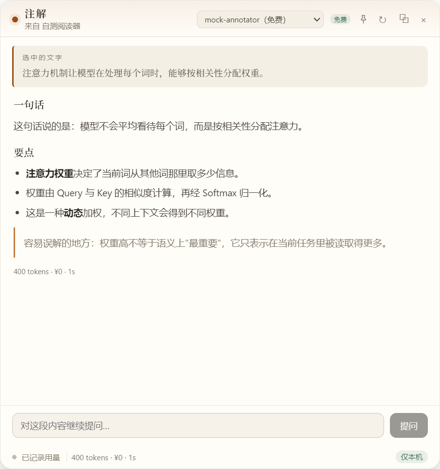
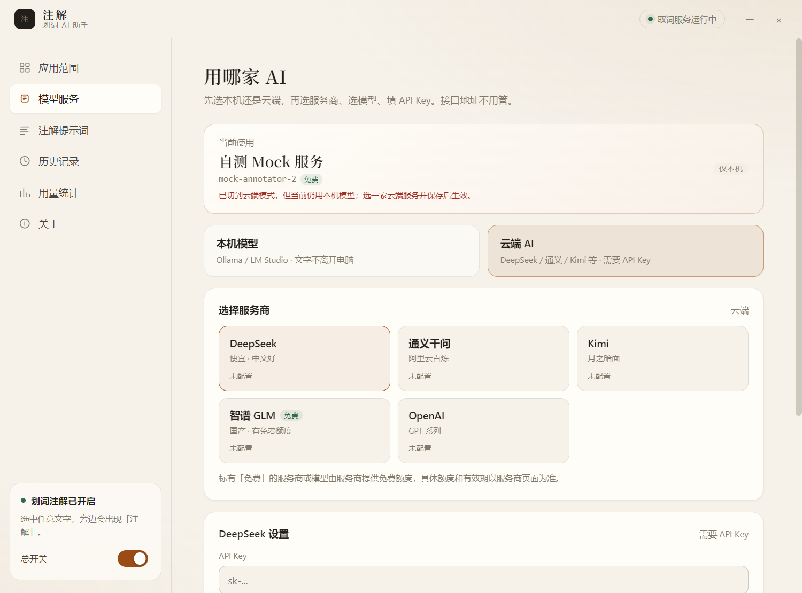
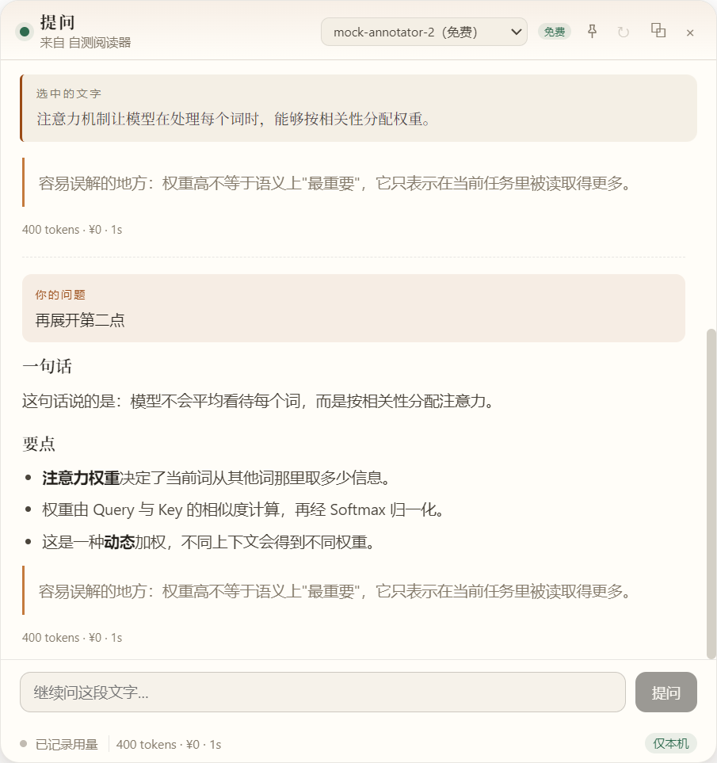
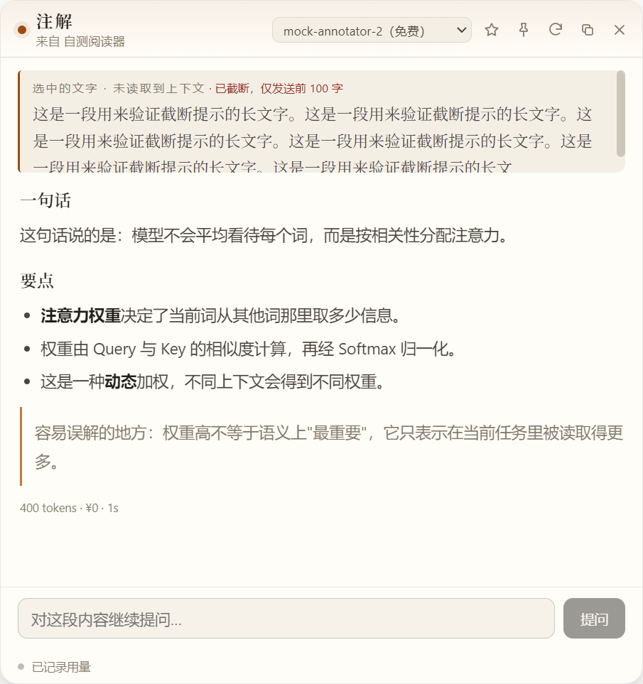
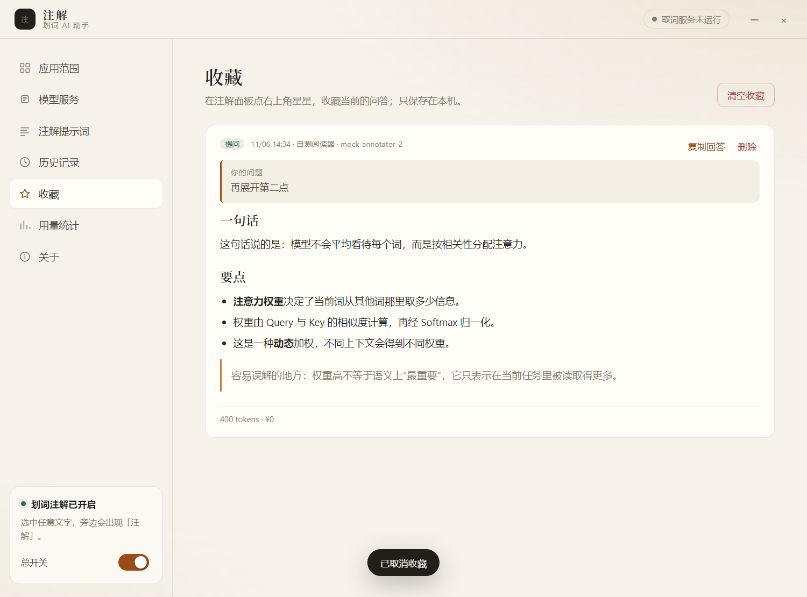
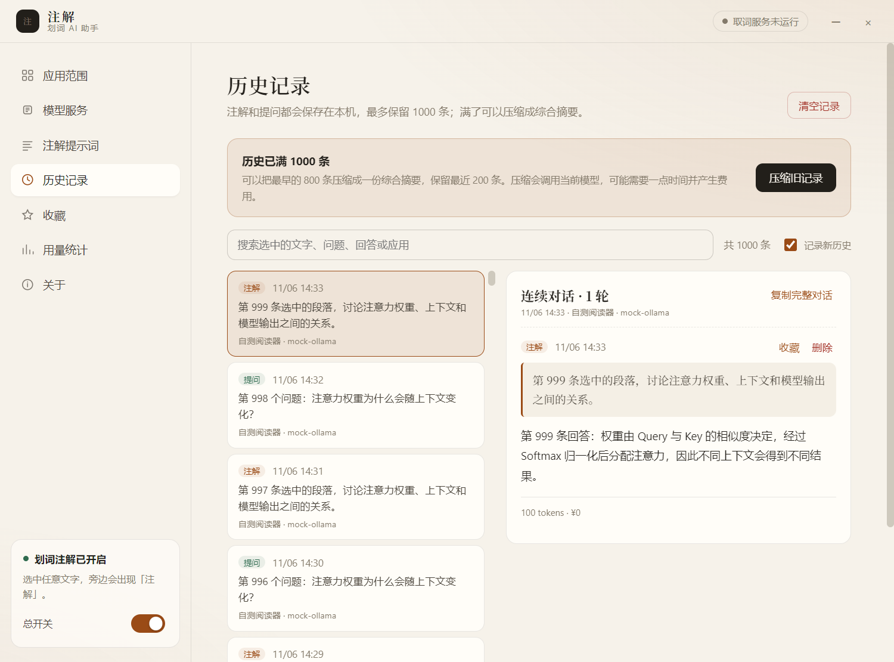
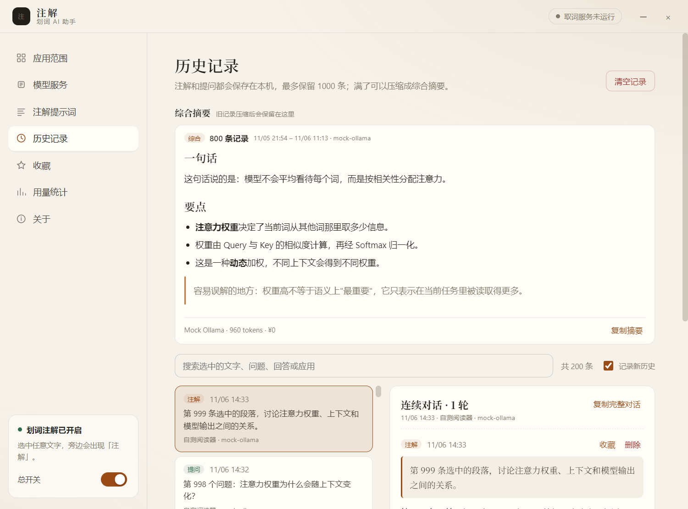

# 注解 · 划词 AI 助手

[](https://github.com/dolee676-sys/annotation-tool/actions/workflows/ci.yml)

> 制作人：piona · MIT License · [GitHub 仓库](https://github.com/dolee676-sys/annotation-tool)

在任意应用里选中一段文字，旁边会出现「注解 / 提问」小框；点开就是 AI 解析或问答。支持本机模型和云端模型，并记录每次调用的 token、费用和历史。

[下载最新版](https://github.com/dolee676-sys/annotation-tool/releases/latest) · [第一次配置](#第一次使用配置-ai) · [常见问题](#常见问题)



## 下载安装（推荐）

> 适用于 Windows 10/11 64 位。绿色免安装版，解压即用。
>
> 下载最新版：[Releases](https://github.com/dolee676-sys/annotation-tool/releases/latest)。

1. 打开 [Releases](https://github.com/dolee676-sys/annotation-tool/releases)，下载 `zhujie-win-x64.zip`。
2. 解压到 `D:\Apps\zhujie`（或任意目录）。
3. 进入解压后的 `win-unpacked` 文件夹，双击 `注解.exe`。
4. 如果 Windows 提示“已保护你的电脑”，点「更多信息」→「仍要运行」。当前版本未做代码签名，这是正常提示。
5. 首次启动会自动打开设置窗口；关闭设置后程序留在右下角托盘，双击托盘图标可再次打开。
6. 想放桌面：右键 `注解.exe` → 发送到 → 桌面快捷方式。

注意：

- 解压后请保留整个文件夹，不要只复制 `注解.exe`，同目录的 `resources` 等文件是程序运行必需的。
- 程序放哪个盘都行；配置、历史、用量默认在 `%APPDATA%\zhujie`。
- 升级：退出应用，替换程序文件夹即可，数据会保留。
- 卸载：退出应用，删除程序文件夹、桌面快捷方式，再删除 `%APPDATA%\zhujie`。

## 第一次使用：配置 AI

应用默认是「仅本机」模式。**如果你没有安装 Ollama / LM Studio，请选「云端 AI」**，否则会提示没有可用模型。

### 免费试用：智谱 GLM-4-Flash

1. 设置窗口 → 左侧「模型服务」。
2. 点「云端 AI」。
3. 服务商选「智谱 GLM」。
4. 点「没有 Key？去 智谱 GLM 获取」，注册/登录后创建一个 API Key。
5. 回到应用，把 Key 粘贴到「API Key」。
6. 模型选 `glm-4-flash`（旁边有「免费」标识）。
7. 点「保存并测试」。显示连接正常即可使用。

> `glm-4-flash` 免费、响应快，适合简单注解；复杂提问和连续追问建议换 `glm-4-plus`、DeepSeek 等更强的模型。

> 每个服务商的设置卡下面都有「怎么配置、怎么购买 tokens」教程：从注册、创建 API Key、充值，到填回应用、选模型、测试，按步骤做即可。



### 或者：本机模型（完全免费、不联网）

1. 安装 Ollama，并下载一个模型，例如 `qwen2.5:7b`。
2. 应用里选「本机模型」→「Ollama」。
3. 点「检测本机模型并启用」。

本机模式只访问 `127.0.0.1`，选中的文字不会离开电脑。

### 其他云端服务商

DeepSeek、通义千问、Kimi、OpenAI 都在列表里。选服务商、粘贴 API Key、选模型、点「保存并测试」即可；配置卡下方的教程会告诉你去哪里创建 Key、去哪里充值或购买 tokens。费用和免费额度以服务商页面为准。

> 云端模式会把选中的文字发送给对应服务商，不要用于敏感内容。带「免费」标识的模型由服务商提供免费额度，具体额度和有效期可能变化。

选择模型时，旁边会显示消耗倍率：以当前 DeepSeek 的 `deepseek-flash` 为 1.00×，精确到 0.01×，按每百万 tokens 的输入+输出价格估算。数字越小越省，本机模型显示「免费」。没有收录价格的模型显示「—」，不会把所有未知模型都误显示成 1.00×；倍率只用于横向比较，实际费用以「用量统计」和服务商账单为准。

## 怎么用

### 划词注解 / 提问

1. 在浏览器、PDF、Word、编辑器等应用里选中一段文字。
2. 文字旁边会出现「注解」「提问」两个按钮。
3. 点「注解」：选中的是词/短语时，按「词义 → 在当前语境 → 作用」解释；如果选中的内容本身是一个问题，会先直接回答问题，再解释其中涉及的概念。
4. 点「提问」：先回答你的问题，再把选中的文字和上下文作为依据，不会只解释选中的文字。
5. 回答完可以继续问。最近 4 轮问答会一起发送，所以“第二点再展开”“用一句话总结”这类指代会保留上下文。



### 面板操作

- 点「注解」后面板会立即出现，上下文在后台读取，不需要先等面板加载。
- 右上角钉子：钉住后点面板外面不会关闭；再点一次取消钉住。
- 未钉住时，点面板外面或按 `Esc` 关闭。
- 顶部可以切换模型；右上角可以复制内容、重新生成。
- 面板默认 600×640，可拖拽、可继续拉伸。

### 结合上下文

默认读取选中位置前后各 300 字，把选中部分标成【选中】后一起发送。

- 不截屏，只读取当前应用向 Windows 无障碍接口暴露的文本。
- 会从划词起点找到真正的源应用窗口，即使注解面板已经打开、拿到了焦点，也能读回原来的窗口。
- 有些应用（例如 OneNote）不直接暴露当前选区，程序会在它的文档全文里按选中文字定位，再截取前后文；仍然取不到时才会显示「未读取到上下文」，并只发送选中文字。
- 失败后不再缓存 2 分钟，每次注解都会重新尝试。
- 可以在「注解提示词」页关闭上下文，或把前后字数改成 100–1000。

### 超长选中

「注解提示词」页可以设置「单次发送上限」，默认 2000 字。选中文字超过上限时只发送前面的部分，面板会明确显示「已截断，仅发送前 N 字」。



### 历史、用量、应用范围

- **历史记录**：同一次注解里的所有追问会按「一次对话」合并，列表显示「N 轮问答」，点开能看到完整的注解和每一条追问；可搜索、复制完整对话、逐条删除或清空。满 1000 条后可以压缩成一份综合摘要，保留最近 200 条。
- **收藏**：回答完成后可以点面板右上角星星收藏；历史记录里的每一条注解/追问也能单独收藏。左侧「收藏」页可以查看、复制或删除，只保存在本机。
- **用量统计**：按模型、应用、天统计 tokens、费用和耗时；本机模型费用为 0，页面右上角可以手动刷新。
- **应用范围**：默认所有应用；也可以只允许指定应用。设置里能搜索已安装和正在运行的应用。







## 常见问题

### 选中文字没有出现小框

- 确认托盘菜单里的「划词注解已开启」。
- 检查「应用范围」是否选成了「仅指定应用」，并且没有勾选当前应用。
- 全屏独占游戏或部分全屏视频上，置顶小框可能不可见。
- 以管理员身份运行的应用，可能需要用管理员身份启动「注解」。

### 点开提示没有可用模型

- 去「模型服务」按上面的步骤配置一个模型。
- 选了「云端 AI」：需要填 API Key 并点「保存并测试」。
- 选了「本机模型」：需要先启动 Ollama / LM Studio，并下载至少一个模型。

### 为什么显示「未读取到上下文」

程序会先按划词位置找到源应用，再尝试读取当前选区；如果应用不暴露选区（例如 OneNote），会在应用文档全文里按选中文字定位并截取前后文。只有这些方式都失败时才显示「未读取到上下文」；这时不影响注解和提问，只是少发送了前后文。

### 费用怎么算

本机模型免费。云端按服务商实际账单计费；应用内按内置价目估算，供参考。「用量统计」页能看到每次请求的 tokens 和估算费用。

### Windows 提示不安全 / SmartScreen

当前版本没有代码签名，属于正常提示。点「更多信息」→「仍要运行」即可。请只从本仓库 Releases 下载，不要用来路不明的压缩包。

### 数据在哪里，怎么备份或卸载

- 配置、历史、用量：`%APPDATA%\zhujie`。
- 备份：复制这个文件夹。
- 卸载：退出应用，删除程序文件夹和桌面快捷方式，再删除 `%APPDATA%\zhujie`。
- 历史对话和摘要是明文文件，没有额外加密。如果电脑多人共用，请自行保护用户目录。

### 怎么更新

应用启动后会检查 GitHub Releases，可以在「关于 → 版本更新」关闭「启动时检查更新」。默认只提示发现新版本，不会直接下载；点「下载更新」后才会下载并校验 SHA-256。也可以打开「发现新版本后自动下载」。无论哪种方式，都要再点「重启并更新」才会替换程序；配置和历史会保留，安装失败会自动回滚到旧版本。也可以随时点「检查更新」或「打开发布页」手动处理。

## 进阶设置

- **模型服务**：切换本机/云端、更换模型、查看免费标识与消耗倍率。
- **注解提示词**：修改注解风格、开关上下文、调整上下文长度和单次发送上限。
- **应用范围**：全部应用 / 仅指定应用，支持搜索进程名。
- **历史记录**：按对话合并追问、查看完整对话、逐条收藏/删除、搜索、复制；可以关闭「记录新历史」；满 1000 条后压缩成综合摘要。
- **版本更新**：启动自动检查；默认提示后手动下载，也可开启自动下载；校验 SHA-256，重启后替换，失败会回滚。
- **关于**：开机启动、查看数据目录。

## 从源码运行（开发者）

> 普通用户不需要看这一节。下载绿色版即可使用。

要求：Node.js ≥ 20、Windows 10/11；单元测试和 CI 使用 Node 24。

```bash
npm install
npm run dev
```

如果 npm 11 拦截安装脚本：

```bash
npm approve-scripts electron esbuild selection-hook
```

国内网络下载 Electron 较慢时：

```bash
ELECTRON_MIRROR=https://npmmirror.com/mirrors/electron/ npm install
```

常用命令：

```bash
npm run typecheck   # 主进程 + 渲染进程类型检查
npm test            # 单元测试与 LLM 客户端错误分支测试
npm run build       # 生产构建到 out/
npm run selftest    # 用本地 mock 模型跑通全链路，截图写入 selftest/
npm run dist        # electron-builder 打包
```

### 打包与安装到本机

```bash
npm run build
npx electron-builder --win --dir --x64 --config.win.signAndEditExecutable=false
powershell -ExecutionPolicy Bypass -File scripts/install-shortcut.ps1
# 如需改安装位置：
# powershell -ExecutionPolicy Bypass -File scripts/install-shortcut.ps1 -InstallDir 'D:\Apps\zhujie'
```

`signAndEditExecutable=false` 是为了绕开本机 Windows 无法创建符号链接、导致签名工具解压失败的问题。安装脚本会先调用 `scripts/patch-exe.ps1`，把 `build/icon.ico` 和版本信息写入 exe，再复制到安装目录；如果只打包不安装，需要手动运行一次 `scripts/patch-exe.ps1`。

### 项目结构

```text
src/main/index.ts        应用生命周期、IPC 编排、流式请求与用量落库
src/main/selection.ts    全局取词、鼠标/键盘钩子、物理像素 → DIP
src/main/selectionCore.ts 取词服务启动/停止/失败重试
src/main/context.ts      从划词窗口读取前后文，支持文档全文定位
src/main/windows.ts      小框 / 注解面板 / 设置窗口 / 托盘
src/main/ai.ts           Ollama 原生 + OpenAI 兼容流式客户端、token 统计
src/main/settings.ts     配置持久化、应用白名单、密钥加密、提示词迁移
src/main/usage.ts        JSONL 用量记录
src/main/history.ts      JSONL 历史对话与综合摘要
src/main/favorites.ts    收藏存储
src/main/compress.ts     历史分批归纳与最终综合摘要
src/main/updates.ts      更新检查、SHA-256 校验、安装失败回滚
src/main/updateSafety.ts 更新校验、安装结果解析与校验失败清理
src/main/applyUpdateScript.ts 更新时替换文件/备份/回滚的 PowerShell 脚本
src/main/security.ts     本地页面信任判断（导航 / IPC 共用）
src/shared/presets.ts    服务商预设、免费模型标识、配置/充值教程
src/shared/pricing.ts    内置人民币价目与费用估算
src/shared/version.ts    版本号比较
src/preload/index.ts     设置窗口的 IPC 桥
src/preload/panel.ts     注解面板的最小权限 IPC 桥
src/preload/chip.ts      划词小框的最小权限 IPC 桥
src/renderer/            React 界面（单入口按 hash 分流）
src/shared/types.ts      主进程 / 渲染进程共享契约
tests/core.test.ts       纯函数、提示词、提问/注解模式、导航安全单元测试
tests/ai.test.ts         OpenAI / Ollama 解析、401、坏行、中止测试
tests/selection.test.ts  取词服务启动失败、错误保留与重试测试
tests/updates.e2e.test.ts 更新包校验失败删除、替换成功、替换失败回滚
tests/history.test.ts    历史压缩/删除/清空失败回滚
tests/settings.test.ts   设置写盘失败、密钥加密与读取
tests/compress.test.ts   压缩提交失败时旧记录保留
```

### 安全边界

- 小框、注解面板、设置窗口分别使用独立的 preload：小框只有 `chipClick`，面板只有 `panel:*` 与复制，只有设置窗口能读写配置、历史和用量。
- 三个窗口都启用 `sandbox`、`contextIsolation`，关闭 `nodeIntegration`。
- 拦截 `will-navigate` / `will-redirect` / `will-frame-navigate`：非应用自身页面的导航一律阻止，http/https 链接交给系统浏览器打开。
- 所有 IPC handler 校验发送方 URL，非本地应用页面直接拒绝。
- 生产构建 CSP 使用 `connect-src 'self'`，并禁用 `object`、`base`、`frame`。

### 数据与隐私

- 配置：`%APPDATA%\zhujie\settings.json`
- 用量：`%APPDATA%\zhujie\usage.jsonl`（最多保留 20000 条，超出后按批整理）
- 历史对话：`%APPDATA%\zhujie\history.jsonl`（最多 1000 条）
- 历史综合摘要：`%APPDATA%\zhujie\history-summaries.json`（最多 50 份）
- 收藏：`%APPDATA%\zhujie\favorites.json`（最多 500 条）
- API Key：Electron `safeStorage` 加密后写入配置；渲染进程只能看到“是否已保存”，拿不到明文
- 默认「仅本机」：只允许 `localhost` / `127.0.0.1` / `::1` 的地址；关闭后才会访问你配置的云端接口
- 无账号、无遥测、无云同步
- 历史对话和摘要是明文 JSONL/JSON，只保存在本机
- 自定义接口填写的输入/输出价格会优先用于费用估算，不会被内置价目覆盖

### 验证记录

<details>
<summary>开发验证记录（2026-11-05，点开）</summary>

- `npm run typecheck`：通过
- `npm test`：32 项通过（价目、消耗倍率、免费标识、选区标记、多轮追问、提问先作答、选中问题先回答再解释、词/问题/段落分流、导航信任、版本比较、更新包校验/结果解析、更新脚本成功替换、失败回滚、历史压缩提交/失败回滚/清空回滚、设置写盘失败与密钥加密、压缩提交失败保留旧记录、旧用量 latencyMs 守卫、OpenAI SSE、Ollama NDJSON、401、坏行、中止、模型列表、取词服务生命周期）
- `npm run build`：通过（主进程 / 3 个 preload / 渲染进程）
- Release 工作流现在会先跑 `npm test`，再构建和发布，测试失败不会出包
- `npm run selftest`：通过
  - 模拟划词 → 小框 → 面板 → 流式输出 → 入库
  - 注解 2 次、提问 2 次，加历史压缩等共 7 次请求 / 4260 tokens；`turns=2`，验证追问带上了上一轮回答
  - 历史记录按会话合并：自测生成 2 个对话，每个显示「2 轮问答」，详情能展开全部问答
  - 历史收藏：逐条收藏后收藏数 +1，再次点击取消收藏后恢复
  - 更新器 E2E：临时目录模拟替换成功；故意让复制失败，确认旧文件回滚；校验和不匹配时删除下载文件
  - 历史压缩：模拟 1000 条 → 压缩最早 800 条 → 保留 200 条、生成 1 份摘要
  - 历史上限：文件 1004 行，压缩后重写为 200 行
  - 安全边界：面板 preload 只暴露面板能力；设置窗口不暴露面板/小框能力；面板导航到本地非应用页面后 URL 仍停留在 `#panel`
  - 模型教程：设置页展开服务商教程并截图 `selftest/provider-guide.png`
  - 超长选中：上限 100 字时面板显示「已截断，仅发送前 100 字」
  - 取词服务：自测主动停止全局钩子，避免真实桌面划词干扰；单独的生命周期测试覆盖启动失败与重试
- 更新：GitHub Actions CI 与 Release 均成功；v0.1.13 安装包附带 SHA-256 校验文件，并与 Release 资产 digest 一致
- 打包版：安装到 `D:\Apps\zhujie` 后执行 `--selftest`，exit=0、requests=7

未验证：真实 Ollama / LM Studio 推理、真实第三方应用中的系统级鼠标点击、NSIS 安装包、macOS / Linux。

</details>

### 参考项目与许可证

本项目以 MIT 发布。调研与使用情况如下：

| 项目 | 许可证 | 用法 |
| --- | --- | --- |
| [0xfullex/selection-hook](https://github.com/0xfullex/selection-hook) | MIT | **直接依赖**：全局划词取词、坐标、应用名、鼠标键盘钩子 |
| [zcx960/AIA-selection-assistan](https://github.com/zcx960/AIA-selection-assistan) | MIT | 交互与窗口定位思路参考；未整体照搬 |
| [Cherry Studio](https://github.com/CherryHQ/cherry-studio) | AGPL-3.0 | 产品形态调研；未复用代码 |
| [pot-desktop](https://github.com/pot-app/pot-desktop) | GPL-3.0 | 划词翻译交互调研；仓库已归档，未复用代码 |
| [nextai-translator](https://github.com/nextai-translator/nextai-translator) | AGPL-3.0 | 桌面划词产品调研；未复用代码 |
| [STranslate](https://github.com/STranslate/STranslate) | MIT | Windows 划词/OCR 产品调研；未复用代码 |

### 已知限制

- 部分应用不向系统无障碍接口暴露选中文本，此时可能取不到；大部分情况下会自动回退到只发送选中文字。
- 全屏独占游戏或部分全屏视频上，置顶小框可能不可见。
- 首次使用必须先配置模型；没有模型时小框仍会出现，但点开会提示去设置。
- token 数优先取服务端返回的 `usage`；服务端不返回时按字符估算，界面以 `≈` 标记。
- 费用为内置价目估算，实际以服务商账单为准；自定义接口需要自己填写价格。
- 发布包未做 Authenticode 签名；自动更新会校验 SHA-256，但 Windows SmartScreen 仍可能提示。
- 应用扫描基于“有窗口的运行中进程 + 开始菜单快捷方式”，少量带窗口的后台工具/桌面宠物也可能出现；可用「仅指定应用」白名单忽略。
